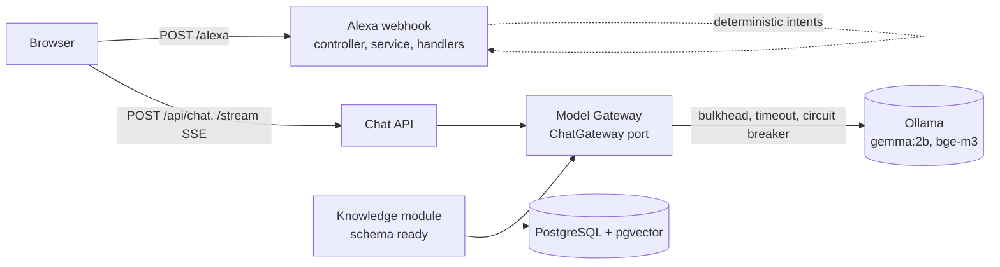

# Architecture

Status: milestone 1 (Model Gateway) complete. Knowledge schema exists; ingestion and retrieval are next.

## Shape

One modular Spring Boot application with explicit module boundaries. It is **not** yet split into
independently deployed services: each module below owns its data and exposes a narrow interface, so
extraction later is a mechanical move rather than a redesign (see ADR 0001).

| Module | Package | Owns |
|---|---|---|
| Alexa assistant | `controller`, `service`, `validation`, `handler`, `config` | Request parsing, verification, intents, sessions |
| Chat | `chat` | Browser chat API, system prompt, input limits |
| Model Gateway | `gateway` | `ChatGateway` port, Spring AI adapter, resilience decorator, health |
| Knowledge | `db/migration` (schema only so far) | Documents, chunks, embeddings (pgvector), full-text index |

## Principles applied

- **Dependency inversion:** callers depend on `ChatGateway`, never on Spring AI or Ollama types.
- **Decorator:** `ResilientChatGateway` adds a concurrency limit, hard timeout and circuit breaker to any gateway.
- **Open/closed:** new Alexa capabilities are new `@Component` handlers; no existing class changes.
- **Graceful degradation (the CAP trade-off we chose):** the app favours availability for deterministic
  features. With the model down, Alexa intents still answer, `/api/chat` returns `503` + `Retry-After`,
  and `/actuator/health` reports `DEGRADED` (HTTP 200) rather than `DOWN`.
- **Fail fast on bad config:** `AlexaProperties` is validated at startup; verification without a skill id refuses to boot.
- **Secrets stay out of source:** database and Grafana passwords come from a git-ignored `.env`.

## Error contract

| Condition | Status |
|---|---|
| Malformed JSON / invalid envelope | 400 |
| Unsupported content type | 415 |
| Failed signature or timestamp | 401 |
| Request for a different skill | 403 |
| Model overloaded | 429 + `Retry-After` |
| Model unavailable or timed out | 503 + `Retry-After` |
| Anything else | 500, generic body |

Bodies never contain exception messages, hostnames or class names; details go to the server log.

## Capacity (measured on the target laptop: 12 cores, 15.5 GB RAM, CPU only)

| Model | Result |
|---|---|
| `gemma:2b` | first token about 0.5-0.9 s warm, about 7 tokens/s: default |
| `qwen3.5:9b` | 38 s for a short answer including a 23 s load, about 4.7 tokens/s: too slow for voice |
| `bge-m3` | 1024 dimensions, about 0.7 s for a batch of three warm, about 4 s cold |

Concurrency is capped at 2 because CPU inference slows every request when oversubscribed.

## Observability

`/actuator/health` (liveness and readiness probes enabled), `/actuator/prometheus` with
`assistant_gateway_slots_available` and `assistant_gateway_circuit_state`. Prometheus and Grafana are
optional compose profile `observability`.
