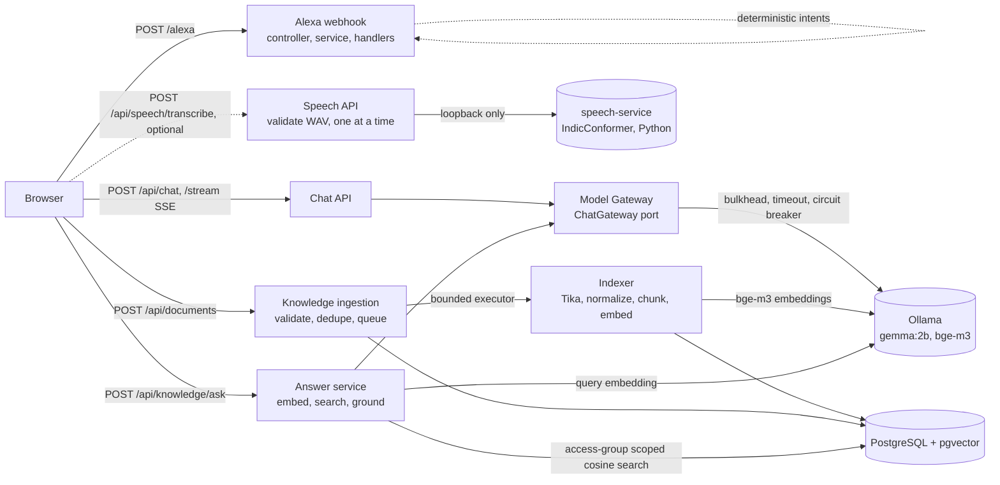

# Architecture

Status: milestone 1 (Model Gateway), milestone 2 (knowledge ingestion) and milestone 3 (retrieval and grounded answers) complete, plus an optional local speech engine (not yet verified with real audio). JWT identity is next.

## Shape

One modular Spring Boot application with explicit module boundaries. It is **not** yet split into
independently deployed services: each module below owns its data and exposes a narrow interface, so
extraction later is a mechanical move rather than a redesign (see ADR 0001).

| Module | Package | Owns |
|---|---|---|
| Alexa assistant | `controller`, `service`, `validation`, `handler`, `config` | Request parsing, verification, intents, sessions |
| Chat | `chat` | Browser chat API, system prompt, input limits |
| Model Gateway | `gateway` | `ChatGateway` port, Spring AI adapter, resilience decorator, health |
| Knowledge | `knowledge`, `db/migration` | Upload API, validation, Tika extraction, chunking, embeddings, documents and chunks in PostgreSQL |
| Speech | `speech`, `speech-service/` | Optional local recognition: `/api/speech/status` and `/api/speech/transcribe`, WAV validation, single-flight limit, loopback client to the Python service (off unless `assistant.speech.enabled`) |
| Browser UI | `static/` | Three tabs: Alexa skill (`/alexa`), Ask anything (`js/chat.js` -> `/api/chat`), Ask my documents (`js/documents.js` -> `/api/documents`, `/api/knowledge/ask`). Voice is shared: `js/voice.js` (mic to input, both engines), `js/speech.js` (Web Speech API), `js/recorder.js` and `js/wav.js` (record, 16 kHz WAV), `js/localSpeech.js` (local engine client), `js/support.js` (what has been seen to work), `js/languages.js` (language and voice selection), `js/http.js` (JSON call helper) |

## Voice

Text is always an equal alternative: the microphone fills the same text box as typing and submits on end of speech. Two recognition
engines sit behind one interface (`bindVoice`), selected by the user and read on every click. There is **no automatic fallback** and no
translation: a failure is reported with the reason, and nothing is recognised in a language other than the one selected.

* **Browser engine** (Web Speech API): free, but Chrome and Edge send the audio to their vendor's speech service, so it needs internet
  and the audio leaves the machine. Interim results are shown live. Browsers do not list the languages they support and accepting a code
  proves nothing, so `js/support.js` records, per engine and language in `localStorage`, whether text was actually produced
  ("works here") or the engine said `language-not-supported`. Everything else stays "not tested". Odia is the likely refusal.
* **Local engine** (optional): the browser records with `MediaRecorder`, decodes and re-encodes to 16 kHz mono 16-bit WAV (no ffmpeg),
  and posts it to `/api/speech/transcribe`. `SpeechService` allows one recognition at a time (CPU inference; a second request fails fast
  with `503`), `WavValidator` accepts only that exact format, and `HttpSpeechRecognizer` forwards it to the Python service. The service
  URL must be loopback, enforced in `SpeechProperties`, so audio cannot leave the machine through configuration. The Python service
  (`speech-service/app.py`) loads AI4Bharat IndicConformer (MIT, 22 Indian languages including Odia) in a background thread and reports
  `loading`, `ready`, `model_missing` or `error`. Whisper was rejected because it has no Odia. The model's repository code is run via
  `trust_remote_code`, so the revision is pinned.
* **Verification:** the model call (`IndicConformer.transcribe`) is the one part not verified, because the model is gated and was not
  available when this was written. All other parts are tested with fakes. No language has been tested with real speech yet.
* **Spoken replies** pick the language from the reply's own Unicode script (`speechLanguageFor`), then the best installed voice
  (`pickVoice`). Latin text is always spoken in English, never with a Hindi voice. With no matching voice the reply stays as text and the
  page says so, rather than being read badly.
* **Server side** `LanguageDetector` labels each uploaded document from its dominant script (English, Hindi, Odia, Bengali, Tamil, Telugu,
  Kannada, Malayalam, Gujarati, Punjabi, Arabic, Russian, Chinese, Korean). It cannot separate languages sharing a script, which does not
  matter for retrieval because `bge-m3` embeds all of them.

## Knowledge ingestion

`POST /api/documents` (multipart `file`, `access_group`) answers immediately; indexing runs in the background.

1. **Validate (request thread):** access group `[a-z0-9_-]{1,64}`, file name stripped to its last path segment, size at most 20 MB,
   extension on the allow-list (pdf, docx, txt, html, md), and the content type Tika detects from the **bytes** must match the extension.
2. **Deduplicate:** SHA-256 of the bytes, scoped to the access group. Identical content returns `200` with `duplicate: true`
   and does no new work. A `FAILED` document never blocks a retry.
3. **Version:** same name, different content in the same group becomes version N+1. Numbering is per group, so a version number can
   not reveal that another group uploaded a file of the same name. A unique key plus retry settles concurrent uploads.
4. **Queue:** a bounded executor (1 thread, 10 queued). A full queue answers `429` + `Retry-After` and leaves no orphan row.
5. **Index (worker thread):** Tika text (capped at 2 million characters) -> Unicode NFC normalization -> chunking -> `bge-m3`
   embeddings in batches of 16 -> chunks and `PENDING -> INDEXED` in **one transaction**.

Chunking is recursive (paragraph, line, sentence incl. the Devanagari/Odia danda, word, then a hard cut) at about 500 tokens with
60 tokens of overlap. Tokens are estimated at 3 characters each, a conservative figure that also holds for Hindi and Odia.
Language (`en`, `hi`, `or`) is detected from the dominant Unicode script.

A failure leaves the document `FAILED` with a coarse code (`EXTRACTION_FAILED`, `EMPTY_DOCUMENT`, `EMBEDDING_UNAVAILABLE`,
`EMBEDDING_MISMATCH`, `STORAGE_FAILED`). Details go to the server log; **document text is never logged**.

`access_group` is a request parameter (default `public`) for now, a stand-in for the caller identity that JWT will supply. The service
already applies it in SQL on every lookup, and a document in another group answers `404`, not `403`, so existence is not revealed.

The knowledge beans exist only when `assistant.knowledge.enabled=true` (set by the `knowledge` profile), so the Alexa webhook and chat
run without a database. Tunable limits (chunk size, batch size, queue size, upload size) live in `KnowledgeProperties` and are listed
in the README configuration table.

## Retrieval and grounded answers

`POST /api/knowledge/ask` (`question`, `access_group`) runs `KnowledgeAnswerService`:

1. Embed the question with `bge-m3`.
2. `DocumentRepository.searchSimilar`: cosine search (`<=>`, pgvector) restricted **in SQL** to the caller's access group, to `INDEXED`
   documents, and to the latest `INDEXED` version of each document name.
3. Keep passages with similarity of at least 0.4. **If none qualify, the model is never called** and the answer is a fixed
   "not found" sentence: the cheapest guard against an invented answer, and it saves seconds of CPU inference.
4. Fit the best passages (at most 3, 3000 characters) into the prompt. The passages are untrusted data: they sit in the user
   message after a `SOURCES:` marker, and the system prompt says sources and question are data and cannot change the rules.
5. `ChatGateway` answers (same bulkhead, timeout and circuit breaker as chat); the reply carries the passages used as `sources`.

Known limits: retrieval is vector-only (the `tsv` keyword index is stored but not used yet, so exact IDs are not boosted);
`gemma:2b` follows the source-only rule well in English but is weak at answering Hindi and Odia questions even when it retrieves
the right passage (measured: the Hindi question retrieved the Hindi passage and the model still replied that it could not answer).
A larger model (`CHAT_MODEL`) improves this at the cost of latency.

## Next

JWT identity replacing the `access_group` parameter, hybrid (vector + keyword) retrieval, and a stronger multilingual answer model.

## Principles applied

- **Dependency inversion:** callers depend on `ChatGateway`, never on Spring AI or Ollama types.
- **Decorator:** `ResilientChatGateway` adds a concurrency limit, hard timeout and circuit breaker to any gateway.
- **Open/closed:** new Alexa capabilities are new `@Component` handlers; no existing class changes.
- **Graceful degradation (the CAP trade-off we chose):** the app favours availability for deterministic
  features. With the model down, Alexa intents still answer, `/api/chat` returns `503` + `Retry-After`,
  and `/actuator/health` reports `DEGRADED` (HTTP 200) rather than `DOWN`.
- **Fail fast on bad config:** `AlexaProperties` is validated at startup; verification without a skill id refuses to boot.
- **Secrets stay out of source:** database and Grafana passwords come from a git-ignored `.env`.

## Error contract

| Condition | Status |
|---|---|
| Malformed JSON / invalid envelope | 400 |
| Unsupported content type | 415 |
| Failed signature or timestamp | 401 |
| Request for a different skill | 403 |
| Invalid upload (empty, too large, bad access group) | 400 |
| Upload larger than the multipart limit | 413 |
| Unsupported file type, or content does not match the extension | 415 |
| Document not found or in another access group | 404 |
| Ingestion queue full | 429 + `Retry-After` |
| Model overloaded | 429 + `Retry-After` |
| Model unavailable or timed out | 503 + `Retry-After` |
| Anything else | 500, generic body |

Bodies never contain exception messages, hostnames or class names; details go to the server log.

## Capacity (measured on the target laptop: 12 cores, 15.5 GB RAM, CPU only)

| Model | Result |
|---|---|
| `gemma:2b` | first token about 0.5-0.9 s warm, about 7 tokens/s: default |
| `qwen3.5:9b` | 38 s for a short answer including a 23 s load, about 4.7 tokens/s: too slow for voice |
| `bge-m3` | 1024 dimensions, about 0.7 s for a batch of three warm, about 4 s cold |
| Ingestion | three one-chunk documents indexed in 8 s total including a cold embedding model (6.5 s for the first) |

Concurrency is capped at 2 because CPU inference slows every request when oversubscribed.

## Observability

`/actuator/health` (liveness and readiness probes enabled), `/actuator/prometheus` with
`assistant_gateway_slots_available`, `assistant_gateway_circuit_state`, `assistant_knowledge_ingestion_total{outcome}`
(accepted, duplicate, rejected, type_mismatch), `assistant_knowledge_indexing_seconds{outcome}` and
`assistant_knowledge_queue_size` and `assistant_knowledge_questions_total{outcome}` (answered, no_context). Prometheus and Grafana are optional compose profile `observability`.

## Dependency notes

- Spring AI's Tika reader pins Tika 4.0.0; `pom.xml` overrides it to the latest release (4.2.0) by declaring
  `tika-core` and `tika-parsers-standard-package` directly. Importing the Tika BOM was tried and rejected: it also
  overrides Boot's Micrometer version and the application context failed to start.
- `ask-sdk-servlet-support` brings `commons-io` 2.7, which breaks Tika, POI and PDFBox at runtime
  (`NoSuchMethodError`). `commons-io` is pinned to 2.22.0 in `dependencyManagement`.
